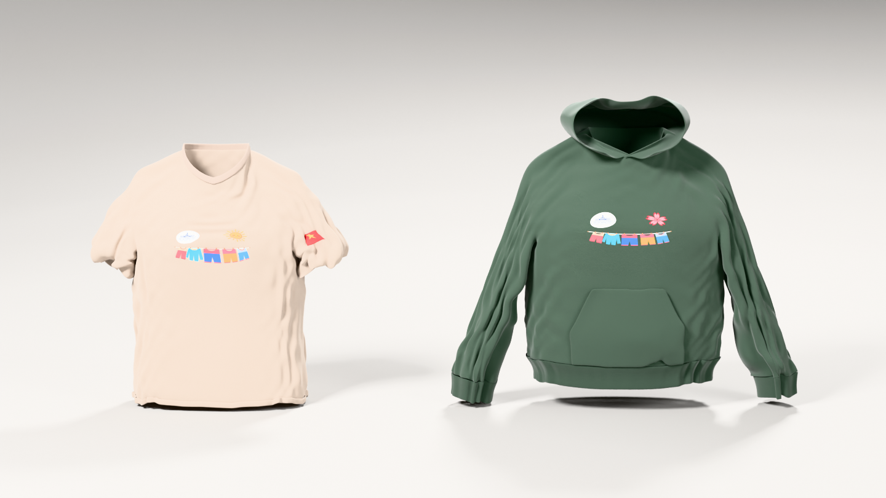
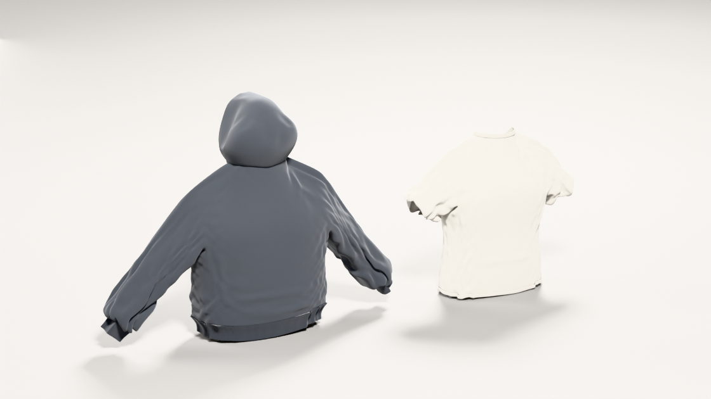

# 3D Blender Shirt & Hoodie Models

**[Live 3D Preview](https://peterachss.github.io/3d-shirt-and-hoodie/)** · Inspect interactive 3D models (`.glb`), switch fabric colorways, toggle clay/wireframe, view Cycles renders, or download `.blend` and `.obj` files.

Parametric quad-topology crewneck T-shirt and pullover hoodie built and cloth-simulated in Blender 4.0 via GitHub Actions.

## Studio lookdev views

| Front hero (Cycles, 85mm, AgX) | 3/4 back lookdev |
| --- | --- |
|  |  |

## Files

- `shirt_and_hoodie.blend`: Ready-to-open Blender scene (`T-Shirt`, `Hoodie`, and `LD_Lookdev` collections) with Subdivision Surface modifiers, Principled BSDF fabric shaders, procedural weave/rib bump, and 85mm 3-point lookdev lighting.
- `blender_studio_render.png` / `blender_lookdev_back.png`: Front and 3/4 back Cycles renders produced by Blender on GitHub Actions.
- `tshirt.obj` / `tshirt.glb`: Cloth-draped crewneck T-shirt with solidified shell, set-in sleeves, ribbed collar, and turned sleeve and waist hems.
- `hoodie.obj` / `hoodie.glb`: Cloth-draped pullover hoodie with dropped-shoulder blouson sleeves, ribbed waistband and cuffs, domed hood, kangaroo pocket, metal grommets, and drawstrings with aglets.
- `shirt_and_hoodie.obj` / `shirt_and_hoodie.glb`: Combined side-by-side scene.
- `garment_builder.py`: Parametric quad-mesh pattern generator.
- `build_garments_blender.py`: Blender `bpy` cloth drape, PBR shader, lookdev lighting, and asset export script.
